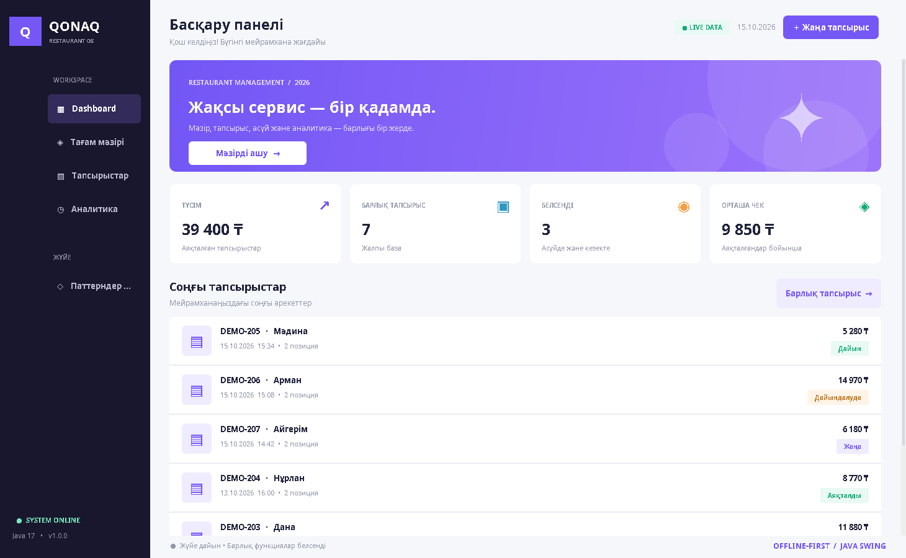
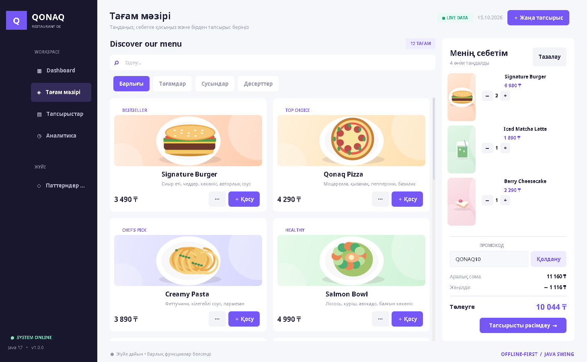
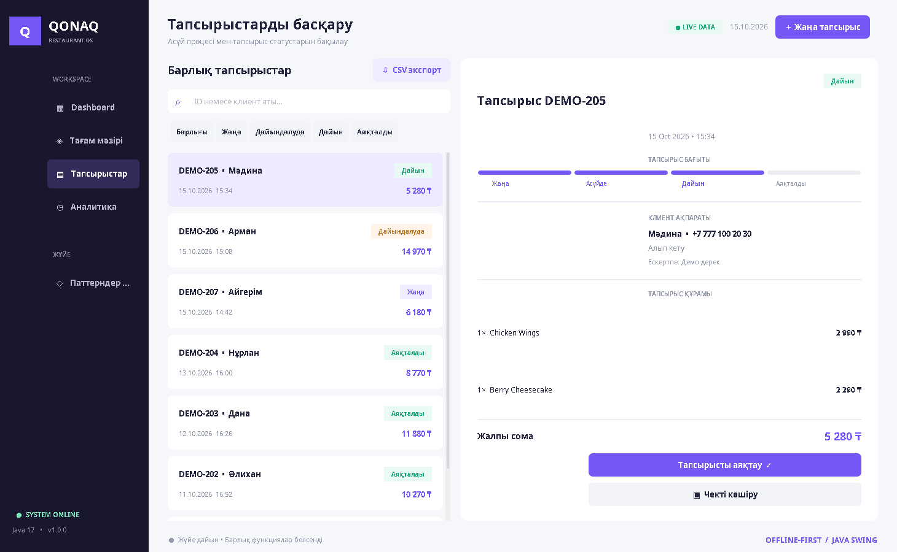
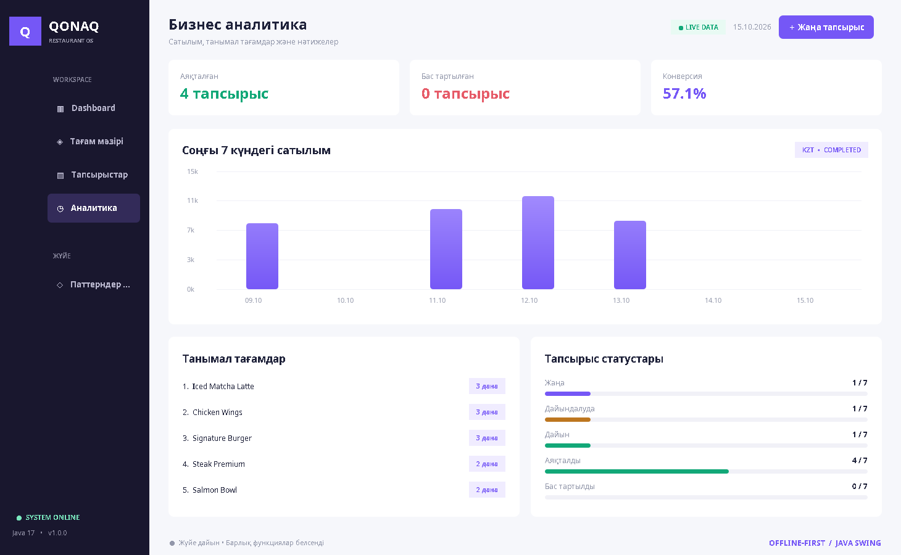
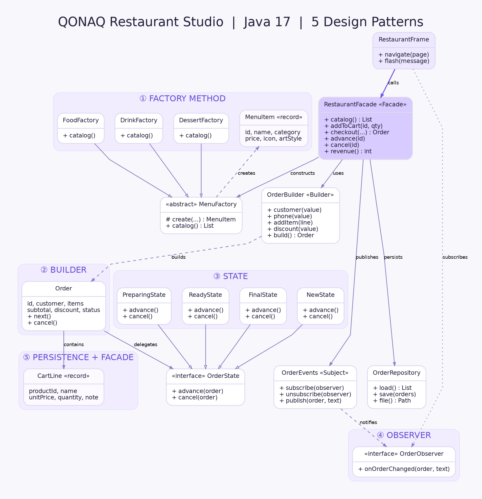

# QONAQ Restaurant Studio 🍽️

**Java 17 • IntelliJ IDEA • Swing Desktop • 5 GoF Design Patterns**

Кәсіби мейрамхана тапсырыс беру жүйесінің оқу жобасы. Интерфейс қазақ тілінде, English UI терминдерімен жасалған. Жоба **интернетсіз** жұмыс істейді, **ешбір сыртқы кітапхана қажет емес**. Деректер компьютерде сақталады.

> Бұл оқу-демонстрациялық desktop жүйе: тапсырыс пен баға есебін жүргізеді, бірақ **нақты банк төлемін, жеткізуші API немесе бұлттық серверді** іске асырмайды.

## 📷 Скриншоттар

| Dashboard | Тағам мәзірі / Себет |
|---|---|
|  |  |

| Тапсырыстар | Аналитика |
|---|---|
|  |  |

Қосымша көріністер: [бос мәзір](docs/preview-menu.png), [рәсімдеу терезесі](docs/preview-checkout.png), [паттерндер бөлімі](docs/preview-patterns.png).

## 🚀 IntelliJ IDEA-да іске қосу (ең оңай жол)

1. ZIP архивін ашыңыз (`Extract All`).
2. **IntelliJ IDEA → File → Open → `QonaqRestaurantStudio`** папкасын таңдаңыз (немесе `pom.xml` таңдауға болады).
3. **Project SDK: Java 17** немесе одан жаңасын таңдаңыз: `File → Project Structure → Project`.
4. Сол жақтан мына файлды ашыңыз:
   `src/main/java/kz/qonaq/app/Main.java`
5. `public static void main(String[] args)` жанындағы жасыл ▶ белгісін басып **Run 'Main.main()'** таңдаңыз.

**Маңызды:** `mvn`, Maven download, Gradle daemon, интернет, браузер немесе деректер базасының сервері қажет емес. IntelliJ `src/main/java` папкасын Source Root деп тануы керек. Егер IDE өзі белгілемесе, папканы тінтуірдің оң жағымен басып `Mark Directory as → Sources Root` таңдаңыз.

Қаласаңыз терминал арқылы:

**Windows:** `run.bat` файлын екі рет ашыңыз (JDK 17+ жүйеге орнатылған болуы керек).

**Linux/macOS:** `./run.sh`

## ✨ Функциялар

- **Dashboard:** түсім, тапсырыстар саны, белсенді тапсырыстар, орташа чек, соңғы тапсырыстар.
- **Мәзір:** 12 дайын позиция, 3 санат, іздеу, offline векторлық тағам иллюстрациялары.
- **Себет:** қосу, азайту, жою, санын өзгерту, босату, ескертпемен тапсырыс қосу.
- **Жеңілдіктер:** `QONAQ10` (10%) және `WELCOME15` (15%), сомалар автоматты есептеледі.
- **Checkout:** клиент аты мен телефонды тексеру, алып кету / үстелде / жеткізу, мекенжай және ескертпе.
- **Kitchen / Orders:** `NEW → PREPARING → READY → COMPLETED` және рұқсат етілген `CANCELLED` күйі.
- **Тарих:** тапсырыстарды ID/клиент бойынша іздеу, статуспен сүзу, тапсырыс детальдары.
- **Чек:** тапсырыс мәтінін буферге көшіру.
- **CSV экспорт:** тапсырыс тарихын Excel ашатын UTF-8 CSV файлы ретінде сақтау.
- **Аналитика:** соңғы 7 күннің сатылым графигі, бестселлерлер, конверсия, статус статистикасы.
- **Observer:** тапсырыс өзгерген кезде экрандарды және төменгі хабарлама жолын жаңарту.
- **Тұрақты сақтау:** файлға жазылады, келесі іске қосқанда жүктеледі.
- **Демо режим:** бірінші іске қосқанда 7 тест тапсырысы жасалады; `Паттерндер / UML` бөліміндегі батырма арқылы тек DEMO жазбаларды өшіруге болады.

## 🧩 Қолданылған паттерндер

| Паттерн | Негізгі класстар | Нақты қолданылуы |
|---|---|---|
| **Factory Method** | `MenuFactory`, `FoodFactory`, `DrinkFactory`, `DessertFactory` | Әр тағам санатына сәйкес `MenuItem` объектісін құру |
| **Builder** | `OrderBuilder` | Checkout кезінде көптеген өрісі бар `Order` объектісін кезеңдеп жинау және тексеру |
| **State** | `OrderState`, `States`, `Order` | Тапсырыстың рұқсат етілген күй ауысулары |
| **Observer** | `OrderEvents`, `OrderObserver`, `RestaurantFrame` | Тапсырыс жаңарғанда тыңдаушыларға хабар беру |
| **Facade** | `RestaurantFacade` | UI-ға бірыңғай сервис/API беру |

Кодпен түсіндірмелер: [`docs/PATTERNS_GUIDE.md`](docs/PATTERNS_GUIDE.md).

**UML Class Diagram:**

- [Редакцияланатын `.drawio` файлы](docs/UML-Architecture.drawio) — https://app.diagrams.net сайтында ашылады.
- [Дайын UML суреті](docs/UML-Architecture.png).
- [Graphviz `.dot` файлы](docs/UML-Architecture.dot) (қосымша).



## 📁 Құрылымы

```text
QonaqRestaurantStudio/
├── pom.xml                 # IntelliJ/Maven метадеректері; dependency жоқ
├── run.bat                 # Windows жылдам іске қосу
├── run.sh                  # Linux/macOS жылдам іске қосу
├── src/
│   ├── main/java/kz/qonaq/
│   │   ├── app/Main.java
│   │   ├── model/          # MenuItem, CartLine, Order, OrderStatus
│   │   ├── patterns/
│   │   │   ├── factory/    # Factory Method
│   │   │   ├── builder/    # Builder
│   │   │   ├── state/      # State
│   │   │   ├── observer/   # Observer
│   │   │   └── facade/     # Facade
│   │   ├── storage/        # OrderRepository
│   │   └── ui/             # Java Swing дизайн және экрандар
│   └── test/java/          # SmokeTest + UiCapture
├── docs/                   # UML, нұсқаулық, UI скриншоттар
└── README.md
```

## 💾 Деректер қайда сақталады?

- **Windows:** `C:\Users\<username>\.qonaq-restaurant-studio\orders.txt`
- **macOS/Linux:** `~/.qonaq-restaurant-studio/orders.txt`

Бұл — UTF-8 мәтіндік, Base64-пен кодталған өрістері бар жергілікті файл; бұл шифрлау емес. Құпия, төлем картасының деректерін сақтауға арналмаған. Жазу кезінде уақытша файл мен атомарлы ауыстыру механизмі пайдаланылады (файл жүйесі қолдаса). `out/` папкасы компиляцияға ғана арналған, Git-ке жіберілмейді.

## 🧪 Автоматты тексеру

`src/test/java/kz/qonaq/tests/SmokeTest.java` — сыртқы dependency-сіз интеграциялық тест. IntelliJ арқылы осы классты **Run** жасаңыз. Қалыпты нәтиже:

```text
SMOKE_TEST_OK: 26 assertions passed
```

Тест уақытша папкада жұмыс істейді, сіздің негізгі тапсырыстарыңызды өзгертпейді.

## 🌐 GitHub интеграциясы

Жоба Git-ке дайын: `.gitignore` бар, барлық бастапқы код, UML және README қосылған. Алдымен IntelliJ-де дұрыс іске қосылғанын растаңыз. Содан кейін оны GitHub репозиторийіне branch/commit/push арқылы байланыстыруға болады. **Бұл архив GitHub-қа автоматты түрде жүктелген жоқ.**

---
**QONAQ Restaurant Studio — оқу жобасы • Java 17**
